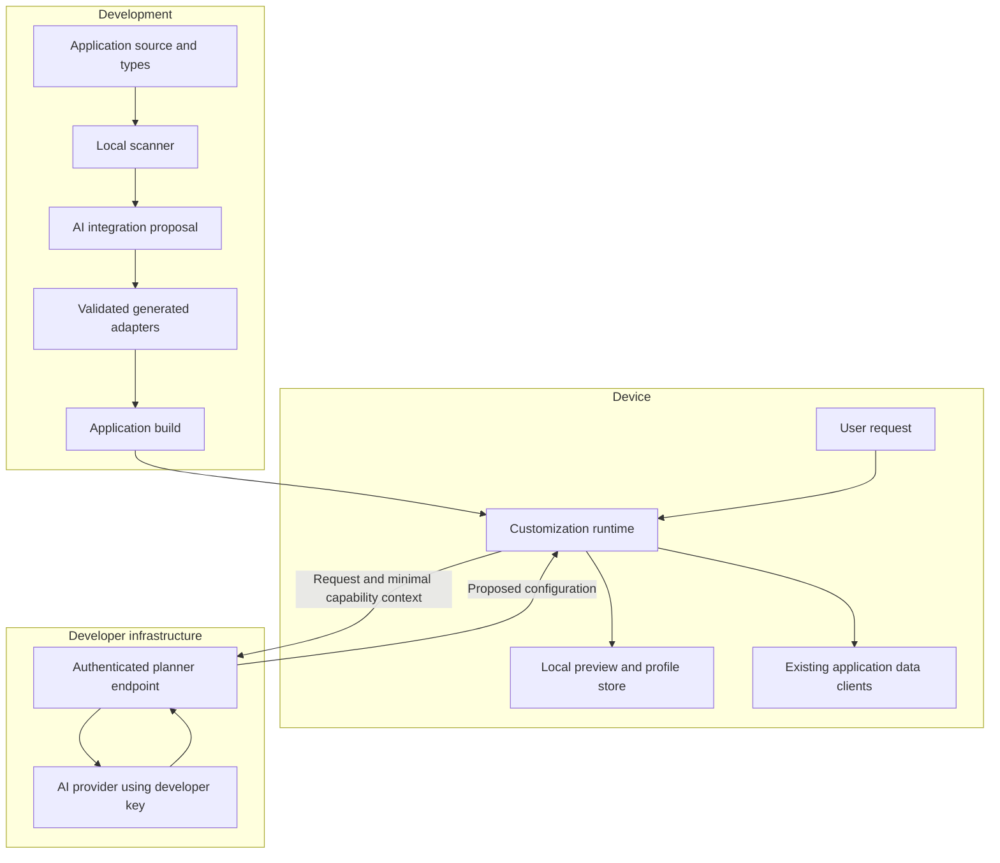

# Open-source React Native SDK and AI installer: MVP implementation plan

Prepared October 11, 2026. This is a proposed implementation, not documentation for an existing package. Package names, APIs, commands, limits, and targets below are illustrative design decisions.

## 1. Product definition and fixed decisions

Build an open-source SDK that lets each user reshape an existing React Native application's appearance, screen composition, navigation, and presentation of existing information through natural-language requests. An AI-assisted installer generates the application-specific integration so developers do not manually register every field, component, and operation.

The SDK must work across application domains. A movie tracker, task manager, shopping application, recipe application, and offline journal should use the same runtime and configuration format. Domain knowledge belongs in generated adapters and descriptions of the host application.

The product promise is: **install the SDK, review an automatically generated integration, and let users personalize the connected parts of the app.** The installer must explain its coverage. An import alone cannot reliably discover every component, data source, business rule, or navigation pattern in an arbitrary application.

Fixed requirements:

- Open-source runtime, installer, schema, server adapter, examples, and tests. No required SDK-vendor account or hosted service.
- Customizations are validated, rendered, and persisted locally on the user's device. No customization database is required.
- Developers use their own AI provider credentials and pay their provider directly.
- Released applications call a developer-controlled AI endpoint. Provider keys remain on the server. The installer can use a separate credential on the developer's machine.
- No dependency on Supabase, Firebase, a particular database, or a particular authentication provider.
- Existing application data continues to use the application's existing storage and authenticated data clients.
- Personal configurations affect only the active local profile. They do not change the application's default interface for everyone.
- Saved interfaces render without another AI request. Offline content availability depends on the host application's data layer.
- Runtime AI output is constrained configuration. Source-code generation happens during installation and development.
- The SDK's own interface ships in one main language initially, with translation keys ready for later contributions.

## 2. MVP capabilities and boundaries

Define the MVP by customization capabilities, rather than by a specific type of application.

| Capability             | MVP behavior                                                                                       | Required integration                                                       |
| ---------------------- | -------------------------------------------------------------------------------------------------- | -------------------------------------------------------------------------- |
| Appearance             | Change approved colors, typography scale, spacing, corner shapes, density, and motion preferences. | Adapter to existing theme tokens or SDK-rendered components.               |
| Screen composition     | Reorder, combine, show, or hide eligible sections; compose a personal home screen.                 | Explicit surfaces and reusable sections, generated where possible.         |
| Collections            | Present an approved collection as a list or grid; apply supported filters and sorting.             | Typed data adapter with correct completeness and pagination semantics.     |
| Grouping and summaries | Group collections or show summaries where the source supports complete, correct results.           | Approved grouping or aggregate capabilities; otherwise report unsupported. |
| Navigation             | Add personal destinations, pin a bounded number of tabs, and reorder eligible destinations.        | Navigation adapter with protected routes and capacity rules.               |
| Existing capabilities  | Add shortcuts to registered screens and item details.                                              | Approved route mapping and validated parameters.                           |
| Persistence            | Save, rename, undo, reset, and restore customizations after restart.                               | Local storage and local profile scope.                                     |

Examples the same engine should handle:

- Movie tracker: create an unwatched-watchlist view, group by an available genre field, and use poster cards.
- Task manager: put overdue tasks above upcoming work, enlarge task text, and add a shortcut to the existing task editor.
- Shopping app: show saved products by brand, use compact cards, and place the saved-items destination first among eligible routes.
- Offline recipe app: prioritize short recipes, display ingredients on cards, and change the reading theme.

Application-wide customization is available only when the integration covers those surfaces. If styles are hardcoded or a screen is tightly coupled to private state, the installer must report partial support or generate a reviewable refactor. It must not claim that wrapping the root component grants complete control.

Defer these features beyond the MVP:

- Arbitrary runtime JavaScript, JSX, SQL, or unrestricted network requests.
- Inventing backend features, new external integrations, or data the host application does not provide.
- AI-controlled execution of payments, deletions, messages, or other domain mutations. Shortcuts can open existing workflows with their existing controls.
- Arbitrary restructuring of active forms, checkout flows, authentication screens, or gesture-heavy custom interfaces.
- Cloud profile synchronization, cross-device preference portability, shared themes, and a marketplace.
- Guaranteed automated integration for every navigation framework and data architecture.
- A maintained on-device inference engine. Keep a transport interface so one can be added later.

## 3. Technical support and coverage strategy

The runtime targets React Native on iOS and Android, including Expo and bare applications. Automatic setup initially supports a documented subset of TypeScript projects. This restriction concerns technical patterns, not application categories or backend providers.

| Area              | Initial support                                                                                                  | Fallback                                                                                 |
| ----------------- | ---------------------------------------------------------------------------------------------------------------- | ---------------------------------------------------------------------------------------- |
| Project discovery | TypeScript source, standard package manifests, common aliases, existing Expo or bare app entry points.           | Generate a report and a small integration scaffold.                                      |
| Navigation        | Expo Router JavaScript tabs/stacks and a conventional React Navigation configuration.                            | Developer supplies the navigation adapter or uses an SDK personalization screen.         |
| Data              | Existing exported typed query functions; complete local repositories; recognized TanStack Query query factories. | Generated adapter requiring a small developer edit.                                      |
| Components        | Exported presentational components with resolvable props and required providers.                                 | Generic SDK card/list/grid mapped to known fields.                                       |
| Appearance        | Existing theme objects/context and declared token consumers.                                                     | Appearance changes inside SDK surfaces; broader coverage requires a generated migration. |
| Storage           | Host storage adapter or optional AsyncStorage adapter.                                                           | In-memory mode for tests and previews.                                                   |
| AI                | Provider-neutral interface, one maintained provider adapter in alpha, a second before public beta.               | Developer-supplied provider implementation.                                              |
| Server            | Framework-neutral request handler plus one small Node/serverless reference deployment.                           | Host framework wrapper around the same handler.                                          |

At kickoff, select and pin an actual React Native, Expo, React Navigation, Node, TypeScript, and provider-SDK compatibility matrix. Test those exact versions in CI. Do not promise compatibility with every version or automatically upgrade a consumer's stack.

Keep optional integrations behind separate exports and peer dependencies. A local repository should not require TanStack Query; a React Navigation consumer should not install Expo Router; mobile bundles must not import server or CLI code.

## 4. Developer setup experience

The intended developer sequence is:

1. Run the installer in an existing application.
2. Supply an AI credential through the local environment, or use an explicitly selected existing coding-agent integration in a later release.
3. Review selected source context before analysis; then inspect the proposed capabilities and generated diff.
4. Resolve only the ambiguities the installer cannot establish from evidence.
5. Configure the runtime planner endpoint and its authentication adapter; deploy it on the developer's infrastructure.
6. Run the generated demo requests and the project's checks.

Proposed CLI commands:

```sh
# Illustrative commands; these packages have not been published.
npx @your-sdk/cli inspect
npx @your-sdk/cli init
npx @your-sdk/cli doctor
npx @your-sdk/cli refresh
npx @your-sdk/cli remove
```

`inspect` performs local, read-only discovery and produces a coverage report. `init` generates and applies a reviewable integration. `doctor` diagnoses compatibility and broken connections. `refresh` proposes updates after application changes. `remove` reverses installer-owned edits when they still match and presents conflicts for anything subsequently modified.

An example report should say:

```text
Supported navigation: Expo Router JavaScript tabs
Connected surfaces: home, library
Connected collection: savedItems
Card renderer: ItemCard
Available operations: filter, sort, list, grid, open detail
Unresolved: whether archivedAt = null means an active item
Unsupported: custom canvas screen
Required setup: planner URL and server authentication callback
```

Avoid invented coverage percentages. Report concrete capabilities, their source locations, verification status, and missing connections.

## 5. Architecture and data boundaries



Only the configuration required for a request is sent to the planner, together with the user's prompt and capability metadata. The runtime does not send the entire movie library, task database, application source, screenshots, or authentication secrets to the model by default. Prompts and selected filter values can themselves contain personal information, so local persistence does not mean that cloud inference is entirely local.

The planner endpoint is stateless with respect to customization profiles. It may use deployment-specific authentication and rate-limit infrastructure, but needs no database of layouts. The model provider receives requests under the developer's own account. Nothing routes through an SDK-vendor service.

The SDK receives existing domain data through host adapters. It does not become a replacement backend or introduce a separate copy of the application's domain records.

## 6. Repository and package boundaries

Use a TypeScript monorepo with four public packages initially. Add packages only when an optional dependency or deployment boundary justifies one.

```text
packages/
  core/src/
    schema/
    capabilities/
    validation/
    patches/
    migrations/
  react-native/src/
    provider/
    surfaces/
    renderer/
    composer/
    navigation/
    storage/
    adapters/
  server/src/
    handler/
    authorization/
    planning/
    providers/
    limits/
  cli/src/
    discovery/
    analysis/
    generation/
    transforms/
    verification/
    commands/
examples/
  movie-app/
  task-app/
  offline-recipe-app/
fixtures/
  installer/
  planner/
docs/
```

`core` has no React Native, server, or provider dependency. `react-native` contains no provider credentials or Node-only code. `server` owns model calls. `cli` owns source analysis and edits. Share schema definitions and validation logic through `core`.

Keep methods focused on one operation and split code by responsibility before files become dense. Treat roughly 250–300 lines as a review prompt, not a requirement to fragment cohesive code. Avoid a single installer script or renderer switch containing the entire system.

## 7. The application integration contract

Generate a capability registry with five categories:

| Category       | What it describes                                                                                               |
| -------------- | --------------------------------------------------------------------------------------------------------------- |
| Surfaces       | Stable places where a layout can be customized, their default layout, and required sections.                    |
| Components     | Available renderers, validated props, supported children/slots, layout constraints, and accessibility behavior. |
| Data sources   | Available fields, supported query operations, pagination, completeness, result schemas, and refresh behavior.   |
| Destinations   | Existing routes, typed route parameters, allowed personal navigation placements, and protected destinations.    |
| Theme controls | Writable tokens, permitted values/ranges, and components that consume them.                                     |

Split the registry into runtime bindings and serializable metadata. Functions, credentials, and authentication context stay in executable host adapters. Only approved descriptions and schemas are candidates for AI context.

Each capability should have a stable ID, version, evidence reference, and status: discovered, proposed, developer-reviewed, or verified by a named check. A model's confidence score is not verification.

An illustrative internal data adapter contract:

```ts
interface SourceAdapter<Row> {
  descriptor: SourceDescriptor;
  query(
    request: ValidatedQuery,
    context: QueryContext,
  ): Promise<QueryPage<Row>>;
  subscribeInvalidation?(onChange: () => void): () => void;
}

interface QueryPage<Row> {
  items: Row[];
  nextCursor: string | null;
  totalCount?: number;
  complete: boolean;
}
```

`SourceDescriptor`, `ValidatedQuery`, and `QueryContext` are types to implement in `core`; this excerpt is an interface sketch. The descriptor declares fields and supported operations. Query context comes from the host application and includes cancellation and the active session. It is never supplied by the model.

Do not universally wrap hook calls as ordinary functions. Where a source exists only as a React hook, generate a dedicated component or hook adapter that follows React's hook rules, or propose a small refactor extracting the underlying query function.

## 8. Configuration and change protocol

Use a versioned, declarative schema with explicit operations. Validate it with a runtime schema library such as Zod. The exact dependency version is selected and tested at kickoff.

A local profile contains:

- Schema version, registry revision, local profile scope, and profile revision.
- Theme overrides using registered token IDs.
- Surface layouts containing registered component references and stable instance IDs.
- Saved views referencing registered data-source IDs.
- Navigation placements referencing registered destinations or saved views.
- Local undo history and a last known good revision.

An illustrative saved view:

```json
{
  "schemaVersion": 1,
  "title": "Upcoming work",
  "sourceId": "tasks.mine",
  "query": {
    "filters": [{ "field": "completed", "op": "eq", "value": false }],
    "sort": [{ "field": "dueAt", "direction": "asc" }]
  },
  "presentation": {
    "componentId": "collection.list",
    "itemRendererId": "task.card",
    "density": "comfortable"
  }
}
```

This example does not reserve any task-specific concept in the SDK. All domain identifiers are registry entries generated for that application.

Start with operations such as `setThemeTokens`, `setSurfaceLayout`, `createView`, `updateView`, `removeView`, and `setNavigationPlacements`. Use discriminated schemas rather than unrestricted object paths. The SDK assigns permanent IDs for new entities when a proposal is committed.

Every proposal includes a request ID, base profile revision, and registry revision. Validate references and constraints before preview. On apply, check the revisions again; a late response must not overwrite a newer user edit or apply after an account switch. Apply the set of changes as one logical transaction and preserve the previous valid profile.

Set explicit limits for component depth, node count, visible navigation items, simultaneous data sources, filter complexity, and output size. Defaults should be configurable within tested ranges. Do not allow executable expressions, arbitrary URLs, user IDs, or backend credentials in generated plans.

## 9. Installer implementation

Build the installer as a sequence of inspectable stages.

1. **Capture the baseline.** Detect project root, package manager, source layout, versions, and existing diagnostics. Record the working-tree state without discarding user changes. Read configuration as data where possible; do not execute arbitrary application modules to discover their exports.
2. **Create a local symbol graph.** Use TypeScript and ts-morph to resolve components, types, imports, route declarations, provider dependencies, query functions, and theme usage. Source manipulation is a supported ts-morph capability. [ts-morph manipulation documentation](https://ts-morph.com/manipulation/)
3. **Select relevant evidence.** Follow data flow from a displayed collection back to its loader and from an item interaction to its destination. Record source locations. Exclude secrets, unrelated files, generated bundles, dependencies, and actual user records from model context. Show the selected context and obtain the developer's agreement before sending source excerpts to their chosen provider.
4. **Ask AI to propose a mapping.** Give the model a bounded discovery graph and necessary code excerpts. Require structured output naming existing symbols and explaining inferred semantics. Treat comments and repository text as source material, not instructions to execute commands or reveal files.
5. **Validate the proposal.** Resolve every referenced symbol, compare props and return types, check adapter support, and detect ambiguous business meaning. Ask focused questions only where the answer materially changes the mapping. Types cannot prove that `archivedAt === null` means active.
6. **Generate small adapters and edits.** Prefer templates and AST transformations. Use bounded AI code generation only for application-specific glue that templates cannot express. No arbitrary model-selected shell commands. Generated output is application source, reviewed and compiled before release.
7. **Show the diff and coverage.** Identify new files, edited entry points, source context sent to the chosen provider, exposed capabilities, and unresolved items. Group routine choices into one review instead of requiring registration one field at a time.
8. **Run checks and a demo.** Typecheck, lint, format, bundle a supported target, run relevant adapter tests, and present example customization requests based on real capabilities. Syntax success alone must not label data semantics verified.
9. **Write an ownership manifest.** Track generated file hashes, source evidence, capability IDs, adapter versions, and edited code markers. Separate generated output from developer overrides. A repeated install must be a no-op when nothing changed.

Use AST edits for root-provider and navigation integration. Preserve existing folders, formatting conventions, and main-language translation patterns. Add a personalization entry point in an existing settings/menu area where possible; do not impose a floating overlay on every app.

A typical consumer integration would contain `personalize/generated/sources.ts`, `components.ts`, `surfaces.ts`, `navigation.ts`, and a serializable `capabilities.json`, plus a developer-owned `personalize/config.ts`. These are proposed relative locations; the installer follows the host's actual structure. It inserts a provider inside existing identity/theme providers, adds the selected customization entry point, and adds only the route files needed by the navigation adapter. Provider hooks, data loaders, and server manifest generation are connected by generated code; the developer should not copy declarations between packages manually.

`refresh` must diff the old and new integration and identify removed fields/components. `remove` only deletes unchanged generated files and safely reversible edits. Changed files require a targeted resolution; neither command should reset the repository.

## 10. Data correctness and generality

The runtime must distinguish complete local data, paginated remote data, and partial cached data.

- A complete local repository can support local filtering, sorting, and grouping within declared size limits.
- A paginated source must apply supported filtering and sorting at the source before pagination, or use a proven equivalent adapter.
- A query cache is a cache, not proof of the complete collection. Never present filtering its loaded pages as a complete result.
- A global count or grouped summary requires an approved aggregate query or a complete collection. Otherwise explain that the request is unsupported rather than displaying a misleading total.
- Mandatory host filters, tenant scope, and authorization are combined with personal filters and cannot be overridden by configuration.
- Support cancellation, cursor handling, deduplication, stable item IDs, errors, refresh, and bounded concurrency.
- Mutations performed in existing app screens must invalidate relevant personalized views. Subscribe to the host's invalidation mechanism or refresh on appropriate lifecycle events.

When integrating TanStack Query, include all result-changing inputs in query identity: active profile/session scope, source ID, filters, sort, and pagination parameters as applicable. This follows its query-key dependency model. [TanStack Query query keys](https://tanstack.com/query/latest/docs/framework/react/guides/query-keys)

Do not infer or add new server capabilities. If a request needs a join or filter the existing client cannot perform correctly, generate a clearly marked adapter task. An OpenAPI or GraphQL schema may help a future discovery adapter, but no schema format is required by the runtime.

## 11. Rendering, surfaces, and navigation

The renderer composes a small set of useful primitives: screen, section, stack, text, collection, approved item renderer, summary, and navigation shortcut. Component registrations can extend this vocabulary.

For a customizable home screen, the installer generates a surface boundary with the original screen as its default. Existing sections become registered renderers with stable IDs. Personal layouts can rearrange those sections or add approved collections. Required controls remain required.

Only one active layout should own live component effects. Do not keep duplicate hidden copies of screens fetching data or running subscriptions. Preserve stable component keys where supported. Do not reparent an active form or assume component state survives a structural change; defer changes until the affected surface is idle when necessary.

Preview should use presentational components and read-only queries. Applying a layout must not execute domain mutations. Original routes and handlers continue to own authentication, validation, and business workflows.

For Expo Router JavaScript tabs, generate a bounded set of optional personal route slots during installation. Populate their labels and saved-view references locally. Expo documents hiding tab buttons with `href: null` and cautions against duplicate dynamic routes in the standard tab layout. Hiding a button is not access control; a route must also validate its current assignment and active profile. [Expo JavaScript tabs](https://docs.expo.dev/router/advanced/tabs/)

For a conventional React Navigation integration, use a compiled generic personal-screen component and configuration-driven screen registration. Preserve route identity, back behavior, and the host's required destinations. [React Navigation bottom tabs](https://reactnavigation.org/docs/bottom-tab-navigator/)

Support an overflow destination when there are more saved views than permitted tabs. Expo custom tabs can express user-data-driven destinations, but its documentation currently marks the feature experimental; keep it outside the required MVP path. [Expo custom tabs](https://docs.expo.dev/router/advanced/custom-tabs/)

Theme changes apply through connected tokens. Clamp or reject values that violate declared readability, component sizing, and motion constraints. Respect system text scaling, focus order, screen-reader labels, and reduced-motion preferences. Validate with real device accessibility behavior, not a claim that schema validation guarantees accessibility. [React Native accessibility](https://reactnative.dev/docs/accessibility)

## 12. Local storage, identity, and recovery

Provide a storage interface so consumers can reuse their existing device storage. Offer an optional AsyncStorage implementation for non-sensitive configurations. React Native documents that AsyncStorage is unencrypted; profiles with sensitive titles or filter values need an appropriate host storage adapter. Tokens and AI keys do not belong in customization storage. [React Native security](https://reactnative.dev/docs/security)

Namespace profiles by app identity, storage schema version, and an opaque local profile key supplied by the host. An offline application can use a device-local profile. An authenticated application can map its existing account identity to a scope; there is no required account system from the SDK.

Store layouts, theme choices, filters, and revision metadata. Avoid storing domain records or complete prompt history by default. A user's new customization does not create a shared server setting.

Serialize writes per scope, retain a last known good revision, and verify persisted payloads before activation. Use copy-before-migrate and a recovery journal or equivalent storage-adapter strategy. Do not assume several key-value writes form a transaction. Fault-injection tests must cover interruption between each write and recovery to a valid profile.

On account changes, cancel in-flight planner/data requests, clear active in-memory results, load the new scope, and reject responses associated with the previous scope. Logout must immediately stop rendering the previous profile. Hosts choose whether to retain its locally stored preferences for later sign-in or erase them; namespace isolation is not encryption.

Version both configuration structure and the capability registry. Migrate supported schema changes deterministically. If a referenced component or data field disappears, disable the affected customization, explain the problem, and offer the original surface or an explicit repair. Never silently broaden a filter or execute a new model request on launch.

## 13. Developer-owned AI endpoint

Expose a framework-neutral planner handler and provider interface. A deployment template can wrap it for a Node/serverless environment. Keep provider adapters replaceable; select the first maintained provider from pilot needs, and demonstrate a second before beta so provider independence is exercised.

The endpoint flow is:

1. Authenticate through a host-supplied verifier and enforce deployment-specific usage limits.
2. Resolve the application and its server-registered capability metadata. The mobile client may request a subset, but cannot expand the approved registry.
3. Validate request size, prompt length, profile/registry revisions, and the relevant configuration subset.
4. Ask the configured model for a structured proposal or a clarification/unsupported response.
5. Validate output against schema and capabilities. Permit at most one bounded repair attempt in the initial implementation.
6. Return a proposal and human-readable change description. Do not save the user's profile on the server.

Generate the mobile registry metadata and server capability manifest from the same source during development. Ship the server manifest with the developer's endpoint; it requires no registry database. Retain manifests for supported older mobile builds, and reject unknown revisions with a recoverable compatibility response. The installer and `doctor` should detect a mobile/server manifest mismatch. A changed application integration may require deploying an updated endpoint as well as shipping the application, while ordinary user customizations require neither.

Proposed request fields: request ID, base profile revision, capability revision, user instruction, and the minimal current configuration needed for the requested change. Identity is derived from verified authentication, not a user ID in this JSON.

Response variants: proposal, clarification, unsupported, retryable error, and rejected configuration. A proposal is not automatically committed. Model failure, timeout, refusal, or invalid output leaves the current profile usable.

For signed-in applications, reuse an existing verifiable session through a generated or developer-supplied adapter. The installer can discover token retrieval but cannot assume that the server knows how to verify it. For guest-only apps using cloud inference, developers must select an explicit access and spending-control strategy. A public mobile application cannot safely hide a shared planner secret; development-only unauthenticated mode must not become a production default.

Runtime model keys belong in the developer's server secret environment. The installer credential belongs in the developer's local environment or selected credential store. They may use separate keys and budgets. Never place either in mobile code, public Expo environment variables, generated configuration, request logs, or command-line arguments. React Native explicitly warns that bundled API keys can be extracted. [React Native security guidance](https://reactnative.dev/docs/security)

Support deadlines, cancellation, bounded retries, maximum output size, and configurable token/usage limits. Provider billing and hosting are the developer's responsibility. No required vendor telemetry; diagnostic collection is explicit and redacts prompts and configuration values by default.

## 14. End-user experience

The default flow is: open customization, describe a change, inspect a preview, apply, and undo if needed. Offer examples generated from actual connected capabilities, such as changing density, rearranging the home screen, or creating a filtered collection.

Show the requested change in ordinary product language. The user should not see adapters, schemas, registry IDs, or unsupported backend implementation details. If a capability is unavailable, explain the missing user-facing behavior and offer available alternatives.

Preview the complete validated proposal. Do not stream partial structural changes into the live app while the model is still generating them. A progress indicator may stream status text, but the current interface remains usable.

Applying a proposal saves a new local revision. Keep a visible path to undo and reset that cannot be removed by a generated layout. Manual controls for basic settings and previously saved layouts should work when the AI endpoint is unavailable.

Separate AI availability from domain-data availability. A saved layout may open offline while a remote collection displays the application's existing offline state. Do not promise that local profiles make every screen's data available offline.

## 15. Quality gates and test strategy

Use strict TypeScript, ESLint with warnings treated as failures for SDK code, formatting checks, package build checks, and mobile-bundle dependency checks. Run focused checks after each meaningful change and the complete release matrix before publishing. Generated code must introduce no TypeScript errors or lint warnings. Existing consumer diagnostics must be reported separately rather than hidden or silently attributed to the installer.

| Test area          | Required evidence                                                                                                                                           |
| ------------------ | ----------------------------------------------------------------------------------------------------------------------------------------------------------- |
| Schema and patches | Unknown IDs, invalid props, excessive depth, disallowed operations, and stale revisions are rejected; valid patches preserve required controls.             |
| Storage            | Restart persistence, undo, interrupted writes, corrupted records, migrations, account switching, and removal of obsolete capabilities recover correctly.    |
| Data adapters      | Complete local filtering and remote pagination match an independent expected result; partial caches never masquerade as complete collections.               |
| Runtime UI         | Home composition, theme changes, personal navigation, detail links, loading/error states, and existing workflows remain usable.                             |
| Installer          | Supported fixtures compile; reruns are idempotent; user edits survive refresh/removal; no secret-containing files enter model context.                      |
| Planner            | Invalid output, hallucinated fields, prompt injection attempts, unsupported requests, timeouts, and concurrent profile edits produce bounded outcomes.      |
| Identity and cost  | Cross-account requests/results are isolated; endpoint authentication and limits are enforced; provider credentials are absent from mobile bundles and logs. |
| Accessibility      | Screen readers, larger system text, reduced motion, keyboard/focus behavior where applicable, and contrast constraints are exercised on supported devices.  |

Use unit and contract tests for core behavior, React Native component tests for interactions, and an end-to-end runner such as Maestro for the cross-app device flows. Select and pin tool versions during kickoff. Use deterministic model fixtures for CI; run a small budgeted real-provider evaluation suite for release candidates. Never make correctness depend solely on nondeterministic model tests.

Keep tests focused on observable behavior and failure modes. Avoid snapshots that merely repeat generated implementation details or tests for every trivial reversible style change.

## 16. Cross-app reference applications

Build three distinct reference integrations using the same packages:

| Application        | Data architecture                                      | Customizations proving generality                                                                     |
| ------------------ | ------------------------------------------------------ | ----------------------------------------------------------------------------------------------------- |
| Movie tracker      | Typed paginated HTTP client.                           | Filtered watchlist, personal destination, list/grid switch, detail navigation.                        |
| Task manager       | Existing query hooks/cache and independent server API. | Rearranged home sections, upcoming/overdue collections, density change, updates after existing edits. |
| Offline recipe app | Local repository with an explicitly complete dataset.  | Personal reading theme, filters, grouped cards, local-only profile persistence.                       |

Exercise at least one bare React Native/React Navigation setup and one Expo Router setup. Avoid making every fixture look like the same starter template. Add installer fixtures for aliases, monorepos, nested navigators, different prop names, and unsupported patterns.

Business-specific logic must remain inside the application adapters. A test should verify that runtime packages contain no movie/task/recipe field names or branches. The meaningful proof is that the same schema and renderer can express the examples without runtime changes.

After the reference apps work, integrate with several independently built pilot apps. Measure supported and unsupported cases separately. Exclude demonstrations that required hidden manual rewrites from the automatic-setup success count.

## 17. Implementation milestones

Each milestone ends with reviewable code, updated documentation, and passing checks. Start with runtime contracts so the installer has a stable target.

| Milestone                    | Deliverables                                                                                                                         | Exit criteria                                                                                                      |
| ---------------------------- | ------------------------------------------------------------------------------------------------------------------------------------ | ------------------------------------------------------------------------------------------------------------------ |
| M0: Contracts and repository | Packages, pinned compatibility matrix, capability schema, proposal protocol, sample configurations, CI, license choice.              | All packages build; boundaries exclude server dependencies from mobile; agreed cross-app scenarios fit the schema. |
| M1: Local runtime            | Profile store, recovery, theme adapter, surfaces, renderer, preview/apply/undo/reset, fake planner transport.                        | Multiple appearances and home layouts persist and recover without a model or server.                               |
| M2: Data and navigation      | Source adapters, list/grid, query validation, pagination, invalidation, protected destinations, initial navigation adapters.         | The three reference apps support structural customization with manually written adapters and correct data.         |
| M3: BYOK planner             | Provider interface, first provider adapter, stateless handler, authentication hooks, limits, output validation, deployment template. | Natural-language requests produce valid proposals; rejected requests cannot change the active profile.             |
| M4: Installer discovery      | Local scan, evidence graph, capability proposal, coverage report, context filtering, dry-run output.                                 | Recognizes supported patterns across unrelated fixtures and accurately flags unresolved semantics.                 |
| M5: Installer integration    | AST transforms, adapter generation, provider/route wiring, ownership manifest, doctor, refresh, remove.                              | A clean supported fixture reaches the demo without handwritten bindings; reruns and reversals preserve user work.  |
| M6: Public alpha validation  | Device tests, second provider adapter, independent pilot installs, performance/usage measurements, debugging docs.                   | Cross-app acceptance suite passes and known limitations are explicit.                                              |
| M7: MVP release              | Versioned packages, migration policy, security reporting, contributor guide, installation videos, release notes.                     | Release gates pass on the published support matrix and the onboarding path works from a clean checkout.            |

Planning estimate: approximately **10–14 weeks for two experienced TypeScript/React Native engineers**, assuming the bounded integrations above and access to pilot apps. This is an estimate, not a delivery commitment. Re-estimate after M2; semantic source discovery and consumer-specific refactors are the largest unknowns. A single-stack internal prototype should precede public compatibility claims.

## 18. Initial engineering backlog

Turn these into issues in dependency order. Each issue should include its observable acceptance condition and any fixture it must pass.

| ID      | Work item                                               | Depends on       | Acceptance condition                                                              |
| ------- | ------------------------------------------------------- | ---------------- | --------------------------------------------------------------------------------- |
| CORE-01 | Capability descriptors and profile schema.              | M0 decisions     | Cross-app sample profiles validate; unknown fields fail.                          |
| CORE-02 | Patch engine and reference validation.                  | CORE-01          | Atomic logical application, stable IDs, stale-revision rejection, undo.           |
| CORE-03 | Schema and registry migration pipeline.                 | CORE-01          | Removed fields disable only affected changes; original surface remains available. |
| RN-01   | Provider, active profile scope, and storage adapter.    | CORE-01          | Restart and account-switch scenarios pass.                                        |
| RN-02   | Renderer and customizable surface boundary.             | CORE-02          | Sections reorder with stable identity and required elements remain present.       |
| RN-03   | Theme-token adapter and constraints.                    | RN-02            | Supported tokens update all documented consumers; coverage is accurate.           |
| RN-04   | Collections and source execution.                       | CORE-01          | Filtering and pagination match fixtures; cancellation works.                      |
| RN-05   | Navigation adapters and overflow.                       | RN-02            | Personal destinations, back navigation, removal, and direct-link validation pass. |
| RN-06   | Composer, preview, apply, undo, and reset.              | RN-01–05         | Full local user flow works with a fake planner.                                   |
| AI-01   | Provider-neutral planner and first adapter.             | CORE-01–02       | Structured proposals and unsupported/clarification responses validate.            |
| AI-02   | Endpoint authorization, limits, and deployment example. | AI-01            | Unauthorized/cost-abuse fixtures fail safely; no keys in mobile artifacts.        |
| CLI-01  | Symbol graph and support detection.                     | CORE-01          | Discovery fixtures identify real source symbols and unsupported patterns.         |
| CLI-02  | Evidence-based AI mapping.                              | CLI-01, AI-01    | Ambiguous semantics are surfaced; invented references are rejected.               |
| CLI-03  | AST edits and generated adapter templates.              | CLI-02, RN-01–05 | Install compiles, preserves conventions, and is idempotent.                       |
| CLI-04  | Doctor, refresh, and reversible removal.                | CLI-03           | Drift is reported and user edits survive.                                         |
| QA-01   | Cross-app contract and device suites.                   | RN-06, AI-02     | Required scenarios pass on iOS and Android.                                       |
| OSS-01  | Packaging, docs, contribution guide, release workflow.  | CLI-04, QA-01    | Clean consumer installation and documented extension example work.                |

## 19. Release acceptance targets

These are proposed targets to measure, not claims of current performance.

- All required behavior tests pass across the three reference applications and supported navigation setups.
- A complete supported fixture can be integrated without the developer authoring a data/component binding. Review, credential configuration, and endpoint deployment are counted separately.
- At least five independent pilot installations are documented, including failures and manual changes. Set a broader automated-install success target after this evidence exists.
- Supported pilot onboarding should aim for a first working customization within 20 minutes, excluding external deployment provisioning. Publish median time, manual edits, and clarifying questions rather than a best-case demo.
- At least 90% of a curated 60-request cross-app evaluation set produces the intended valid result within the allowed planning attempt and one repair. All rejected results leave the app intact. Report semantic correctness separately from JSON validity.
- Saved configurations require zero model calls to reopen. The customization system does not add model calls to ordinary screen rendering.
- SDK packages and generated supported fixtures have zero TypeScript errors and zero lint warnings. The supported release matrix passes package, component, and device checks.
- No cross-profile configuration or cached-result leakage in account-switch tests; no provider secrets in mobile bundles.
- Startup, layout switching, list scrolling, memory, and package-size overhead are measured on a named mid-range Android device and supported iPhone. Establish budgets at M1 and enforce them thereafter; do not invent performance numbers before measuring.

Record installer coverage, repair frequency, invalid proposal rate, time to first customization, and user undo/reset frequency during opt-in pilots. A high undo rate may indicate poor interpretation even if schemas validate.

## 20. Open-source maintenance and required developer steps

Select a permissive license before accepting contributions; MIT is a proposed default, subject to maintainer choice and dependency review. Publish contribution guidance, a code of conduct, security reporting instructions, a compatibility policy, and a clear separation between stable and experimental adapters.

Keep extension contracts documented and tested. Include examples of a custom data source, presentational component, navigation adapter, storage adapter, and model provider. Maintain a changelog and explicit configuration migration notes. Pin release workflows and review dependency changes. Do not make a future hosted product necessary to use the open-source path.

Consumers should expect these manual steps:

1. Review the generated source changes and the application capabilities being connected.
2. Resolve ambiguous field meanings or unsupported source patterns. Some apps will need a small custom adapter or a generated refactor reviewed by their developer.
3. Set the installation AI credential locally and the runtime AI credential in server secrets.
4. Supply or confirm the endpoint's authentication/usage policy and deploy it on their infrastructure. Apps with no backend need this small endpoint for shared-key cloud inference, or a future on-device provider.
5. Configure the non-secret endpoint URL and connect local profile identity when the app has multiple users.
6. Run the generated demo requests, type/lint checks, and platform smoke tests; then ship the updated application through their usual process.

Once that integration is shipped, users can create supported personal interfaces without a developer release for each configuration. Adding fundamentally new application capabilities or connecting previously unsupported surfaces remains a development task.

The implementation is complete when the same open-source runtime can perform useful appearance, composition, data-presentation, and navigation changes in unrelated applications; the installer can generate the supported integrations; configurations stay local; and all AI calls use credentials controlled by the application developer.
