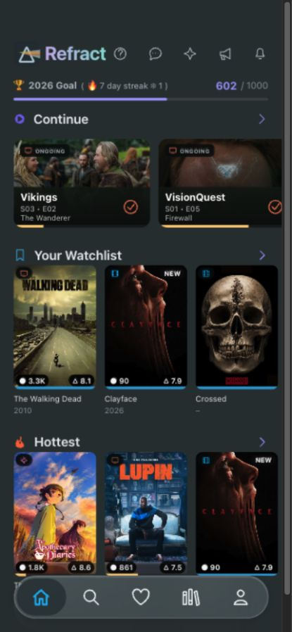
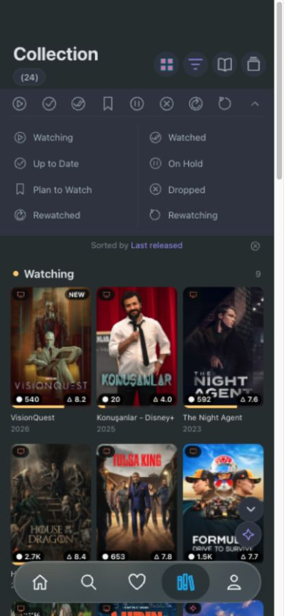

# Refract → Customitin adoption test

**Historical first test.** The example has since been simplified and the SDK extended. See [the repeat test](../refract-sdk-controls/report.md) for the current integration without manually built target controls. The findings below describe the original run.

Test date: October 28, 2026. Platform: React web / Vite, inspected in the in-app browser at a 430 × 930 phone viewport. Reference: the two screenshots supplied with the request.

**Result: the complete developer → SDK integration → end-user AI workflow worked after fixing the issues below.** A real GPT-6.1 Sol request composed Collection from the app's existing components and complete library source. The resulting screen supports status filtering, sorting, card details, density changes, apply, reload persistence and undo. A second successful live request reduced the layout to Watching; undo restored all eight groups without another model request.

The result is a close visual reproduction, not a claim of pixel-identical native rendering. This is a web test app with 24 fixture records, rather than the original app's 814 records. Several icons, typography details and artwork overlays remain approximate. There is no production media service or native-device build of this example.

**What was built before SDK adoption**

The host app lives in [examples/refract-app](../../examples/refract-app). Home was built first as ordinary React/CSS: Refract branding, the annual goal meter, Continue episode cards, Your Watchlist, Hottest, poster metadata, progress bars and a floating five-tab navigation bar. Horizontal shelves, episode indicators, title details, search, favorites and library controls have local behavior. Social/notification controls show local messages.

The supplied screenshots are bundled as CSS artwork atlases, including the prism logo. This keeps the recognizable artwork without depending on external image URLs. Cards, headings, badges, progress, controls and navigation are real components. Some atlas regions still contain small baked screenshot overlays; these are not clean original poster assets. The Continue cards use a dark text region to cover the screenshot's original labels. Licensed original assets would be needed for a distributable product.

The fixture has stable record IDs and all eight statuses. Its 24 records include separate sample records that reuse some artwork. Watching has 9 records; Plan to Watch has 3; each remaining group has 2. The rendered totals are computed from the data. I deliberately did not hardcode 814 or 11 to imitate counts that the fixture cannot substantiate.

The Collection screen initially contained only empty-state copy. Its final host code still contains no prescribed collection layout: it mounts an empty `SurfaceRenderer` and developer-owned assistant controls. The default manifest layout is `[]`. The app never imports the recorded model-response test fixtures.

| Original host baseline                          | Collection produced through the SDK                                      |
| ----------------------------------------------- | ------------------------------------------------------------------------ |
|  |  |

The [final Home screenshot](assets/home-final.jpg) includes the supplied prism logo; the baseline above preserves the pre-integration evidence.

**How SDK adoption was tested**

1. Built and checked the standalone Home UI, then recorded its appearance before installing Customitin.
2. Packed the local SDK into npm tarballs and copied the app to `/tmp/refract-adoption/app`, outside the monorepo. Installed core/React as runtime packages and server/CLI as development packages. The isolated app resolved installed packages, not workspace TypeScript aliases.
3. Ran the installed `customitin inspect --json`, reviewed the digest, excluded the app root, provider, low-level icon/card and Continue components, and attempted a dry run. This exposed the named-root and discovery issues described below.
4. Rebuilt/reinstalled the fixed CLI, repeated discovery, approved the reviewed digest, inspected the dry run and applied the installation. `doctor --typecheck` passed. The generated provider is inside the existing `LibraryProvider`, so reused controls retain their host context and callbacks.
5. Added the developer-owned `collection` surface policy and planner configuration, refreshed the generated bindings, and checked the isolated consumer again. A missing `@types/node` dependency in the new host server tooling was found and added.
6. Opened the isolated app and made the live end-user requests through its actual assistant UI. Requests travelled through `useAssistant` → `createHttpPlanner` → the authenticated local `createPlannerHandler` → `createOpenAIProvider`, then through both server and client validation before preview.

The four approved reusable components are:

| Host component   | Information supplied to Customitin                                                                                                                         |
| ---------------- | ---------------------------------------------------------------------------------------------------------------------------------------------------------- |
| `MediaShelf`     | Typed media rows, title, rail/grid layout, status, actual-count display, and an explicit two/three-column setting. It renders the same cards used on Home. |
| `LibraryHeading` | Title and a typed item-ID list; the count comes from the bound rows. Existing host controls change density and focus filtering/sorting.                    |
| `StatusFilters`  | Expanded/collapsed presentation; the eight status labels and shared local filter behavior remain host code.                                                |
| `SortControl`    | Existing Last released / Title / Rating sorting behavior shared with the shelves.                                                                          |

The approved complete `loadLibrary` source exposes 11 scalar fields: ID, title, year, status, poster key, kind, comment display, rating display, progress, release value and new flag. Status is an enumerated type. There are no cached or partially loaded records. Only layout/data operations on `collection` are allowed. No domain actions, Home edits, arbitrary URLs, model-generated code or navigation changes are enabled.

Descriptions and types alone cannot teach the model hidden component behavior. The first completed request correctly exposed that limitation: “grid” did not prove a three-column capability. Adding a typed `columns` prop made that capability explicit rather than asking the model to guess.

**Live requests and evidence**

Every API attempt used the existing ignored `.env` key, server-side only, with exactly **`gpt-6.1-sol` and `reasoning_effort: "xhigh"`**. Each completed API response also reported `gpt-6.1-sol`. No substitute model or deterministic planner was used for the live interaction. The existing SDK uses Chat Completions JSON mode here; no function calls are involved. The effort setting follows [OpenAI's reasoning API documentation](https://developers.openai.com/api/docs/guides/reasoning#reasoning-effort).

The SDK's request contract is text-only. I translated the supplied Collection screenshot into an ordinary end-user instruction: Collection heading and true count, expanded status filters, Last released sorting, three-column poster groups in the reference's status order, original card metadata, and no Home changes. The screenshots themselves were not uploaded to the model. The full editable instruction is in the English dictionary and the app's assistant input.

| Attempt                                  | Result                                                                                                   |      Time |                         Reported tokens |
| ---------------------------------------- | -------------------------------------------------------------------------------------------------------- | --------: | --------------------------------------: |
| Initial collection request               | Client aborted at its hardcoded 30-second deadline. No saved layout changed.                             |  29.992 s |     Unknown; no response usage received |
| Same request with configurable deadlines | Valid `unsupported` response: exact three-column presentation was not exposed by the component contract. |  68.316 s |  6,146 input + 2,896 completion = 9,042 |
| Same request after exposing `columns`    | Valid collection proposal, previewed and applied. No repair attempt.                                     | 108.570 s | 6,166 input + 7,328 completion = 13,494 |
| “Only Watching” refinement               | Valid layout-only proposal, applied, then undone successfully. No repair attempt.                        |  11.584 s |    8,098 input + 799 completion = 8,897 |

The three completed responses total **31,433 reported tokens**, including **6,707 reasoning tokens** within completion usage. This excludes any work billed for the cancelled attempt. Dollar cost was not returned and is not estimated here. These few requests establish feasibility, not a statistically meaningful success rate or latency guarantee.

The successful initial proposal contains nine data views and 11 layout nodes. One view supplies IDs for the total count; eight views filter `status` and sort `released` descending for their respective groups. The layout uses the four approved components only. The follow-up replaces the surface layout with heading, filters, sort control and Watching, reusing existing data views.

Evidence retained in the repository:

- [Safe live model/latency/usage summary](live-summary.json).
- [Exact initial successful proposal](../../tests/fixtures/refract/collection-response.json) and [exact refinement proposal](../../tests/fixtures/refract/watching-response.json).
- [Empty Collection](assets/empty.jpg), [model preview](assets/preview.jpg), [filtered collection](assets/filtered.jpg), and the screenshots above.
- [Consumer interaction tests](../../tests/refract-interactions.test.tsx), which replay those recorded outputs through the actual generated root/bindings.

Raw local audit files are in `/tmp/refract-adoption/artifacts/live`. They contain approved request context, raw responses and usage, but no HTTP authorization headers or environment variables. They were not added to the repository. Those temporary files may be cleaned up by the OS.

**Problems fixed during the test**

| Problem                                                                                            | Change and verification                                                                                                                                                                                                                                                                                                                                                                                   |
| -------------------------------------------------------------------------------------------------- | --------------------------------------------------------------------------------------------------------------------------------------------------------------------------------------------------------------------------------------------------------------------------------------------------------------------------------------------------------------------------------------------------------- |
| A normal `export function App()` Vite root could not be installed automatically.                   | Added explicit named `App` support in conventional `App.tsx` files, preserving provider order and existing default-export rules. Compiling function/arrow fixtures verify installation, idempotent refresh, host edits and removal. The Refract interaction tests also run the generated named-root integration.                                                                                          |
| Exported arrays contributed prototype methods such as `reverse()` as source candidates.            | Discovery now skips array, readonly-array and tuple prototype methods while retaining actual repository loaders. Regression coverage checks both behaviors.                                                                                                                                                                                                                                               |
| Optional host props were declared nullable even when their TypeScript types excluded null.         | Separated optionality from explicit nullability. Source fields still support the SDK's missing-value-to-null normalization; optional host fields and legacy item adapters remain compatible with omission. Existing and new discovery/consumer checks pass.                                                                                                                                               |
| The OpenAI adapter could not set reasoning effort and silently capped completion budgets at 8,192. | Added typed `reasoningEffort` and validated explicit completion budgets from 1 to 65,536. The app uses 32,768. Transport tests verify the exact model/effort/budget and preserved defaults.                                                                                                                                                                                                               |
| Both server and client limits prevented longer reasoning requests.                                 | Added `plannerTimeoutMs` throughout runtime, React provider and generated root. Both sides have bounded configurable deadlines. This app uses 290 seconds on the server and 300 on the client. Fake-timer tests verify defaults, longer waits, timeout, cancellation, late-output rejection and invalid settings. The 109-second live response confirms the complete generated path forwards the setting. |
| A host “grid” did not expose column count to the model.                                            | Added a typed two/three-column prop to the existing shelf and refreshed the manifest. The next identical end-user request produced the requested layout. This is host integration work, not Refract logic added to SDK packages.                                                                                                                                                                          |
| Generated JSON failed the host formatter, but manual formatting would violate ownership hashes.    | The CLI now formats generated JSON as well as TypeScript before recording ownership. A regression checks formatter-clean output and no-op refresh.                                                                                                                                                                                                                                                        |
| Modal keyboard behavior needed improvement.                                                        | Used native dialogs for focus containment and Escape, with explicit opener focus restoration. Browser checks and interaction assertions cover the detail flow.                                                                                                                                                                                                                                            |

All domain-specific code stays in the Refract example. The SDK changes concern general discovery, typed contracts, generated-file formatting and planner configuration. Developer-owned config/overrides and stable IDs were preserved. Documentation in `docs/ai` was updated and `llms-full.txt` regenerated.

**Behavior checked**

The real browser run verified the empty starting surface, live preview, apply, all eight groups and their actual counts, Plan to Watch filtering, alphabetical card sorting, the two-column density toggle, details, reload persistence, a live Watching-only refinement and undo back to the complete collection. Home remained outside all proposals. Native dialog focus containment and Escape were also checked.

The automated Refract interactions additionally verify discard, empty state after remount, saving only plans rather than media records, a connection failure retaining the saved collection, refinement revision handling and undo without another planner call. These tests replay recorded model JSON with the current request/revision envelope; they are deterministic regression tests, not additional live model successes.

The final `npm run check` passed **140 tests across 34 files**, strict TypeScript, zero-warning ESLint, formatting, all package builds, platform/domain boundaries and documentation freshness. The example's production bundle also built successfully, and `customitin doctor --typecheck` returned no issues or recommendations. A scan of all five browser build files found no copy of the existing API key.

The packed consumer runner separately passed its isolated React web and React Native consumer checks and bundles. That runner's native interaction harness uses React Native Web/jsdom; it is not evidence that this Refract app ran on an iPhone or Android device. Local check logs are `/tmp/refract-adoption/artifacts/check-final.log` and `/tmp/refract-adoption/artifacts/packed-consumers.log`.

An initial restricted-sandbox check could not signal an owned child process and produced follow-on test timeouts under that run. The unrestricted required check passed. Assertions were not removed and timeouts were not increased to hide it.

**Running it and remaining manual work**

From the repository root, run `npm run build` and `npm run dev:refract`, then open `http://127.0.0.1:8086`. The existing `.env` is sufficient for this local test. Open Collection, ask for the layout, inspect the preview and apply it. A fresh browser origin starts empty; the demonstrated isolated app uses `http://127.0.0.1:8087` and retains its applied layout in that origin's local storage. See the [example README](../../examples/refract-app/README.md) for the isolated tarball procedure and audit options.

No deployment is needed to reproduce the local test. To ship a real app, the developer must replace the local fixture and screenshot atlases, implement real account authentication/authorization, deploy the matching server manifest and planner behind HTTPS, configure quotas, and validate the actual media backend's completeness. The example's HttpOnly local session and loopback/origin restrictions are development protection, not production authentication.

Real iOS/Android devices, VoiceOver/TalkBack, text scaling, safe areas, touch target sizing, slow/offline networks, account switching, realistic library volumes and performance remain manual release checks. Temporary host filter/sort/density choices reset on reload; the SDK persists the applied composition and data plans. This test does not claim production reliability, cross-device persistence or exact native typography.

**Conclusion**

The hypothesis holds for this test: a developer can expose the same host components and complete typed data used by Home, and an end user can ask Customitin's AI to build a visually similar Collection view with functional grouping and filtering. The AI supplied layout and query plans; the host supplied the appearance and interactions. The result was not a prewritten collection screen disguised as generation.

The first adoption attempt was not frictionless. It revealed real installer and reasoning-model integration gaps, all addressed above. The clearest product lesson is that visually obvious behavior is not automatically part of the model's contract: column count had to be explicit. With that contract and suitable bounded deadlines, the original request and a subsequent refinement both succeeded through the real SDK workflow. More independent adopters and repeated live evaluations are needed before generalizing that result.
