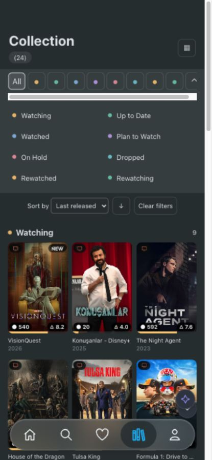

# Refract repeat test: SDK-owned collection controls

October 28, 2026 · React web / Vite · 430 × 930 browser viewport.

**Result: the repeat test succeeded using the original Home card and unchanged library data, with no developer-built target-screen controls.** The SDK now provides a reusable collection component. The runtime AI configured that component through the normal planner connection; it did not generate JavaScript, CSS or event handlers.

The [first test](../refract-adoption/report.md) required a prepared heading, filter panel, sort control and grid-capable shelf in host code. Those were removed for this test. This distinction is the purpose of the repeat.

| Original Home components | Collection configured by the live AI                      |
| ------------------------ | --------------------------------------------------------- |
|  |  |

**What changed in the SDK**

- Core can derive a collection capability from an approved single-record host component and compatible complete source. The descriptor declares the supported fields and presentation props. It retains the original card's source restrictions and requires count permission.
- The CLI accepts `components[card].collection: { source: selectorOrId }`. It generates the ordinary card adapter plus a `.collection` capability and platform binding. Existing config/overrides and stable card identities remain developer-owned/preserved; source/card moves continue to resolve through the identity lock.
- `@customitin/react/dom` supplies the web collection controls. `@customitin/react-native/collection` supplies native controls. Both use a shared state/data model; the default provider and shared React entry remain headless. No Refract names, statuses or media logic were added to SDK packages.
- The SDK implements heading/count, category options, filtering, sorting/direction, grouped sections with counts, grid density, collapse/expand and empty states. It renders each item through the original host card, retaining that card's context and interactions.
- Both sides validate the collection binding. The card and generated collection must be approved on the surface. Field choices respect source filter/sort/group permissions. Bindings require identical field names and a flat, complete local view; they reject remote/paginated data, joins, computed fields and aggregates for this specific component. Partial data never receives a misleading complete-library count.
- The planner's generic instructions describe this optional capability. It remains unavailable unless explicitly registered. Existing host bindings and richer data plans remain supported separately.

Implementation entry points: [core descriptor](../../packages/core/src/collections/descriptor.ts), [binding validation](../../packages/core/src/collections/validate.ts), [shared collection model](../../packages/react/src/collection/model.ts), [web renderer](../../packages/react/src/dom/collection/index.tsx), [native renderer](../../packages/react-native/src/collection/index.tsx), and [CLI generation](../../packages/cli/src/generation/components.ts). Integration instructions are in [the SDK guide](../../docs/ai/integration.md).

**How the host was reduced before testing**

The app's `LibraryControls.tsx` was deleted. `MediaShelf` now renders only the original horizontal Home rail; its grid mode, column prop, group counts, status filtering and sorting were removed. `LibraryContext` now contains only selected-card details state. Home's added expandable library panel was removed. Target control/grid CSS and status-color mappings were removed. Search/favorites also use the ordinary rail rather than retaining a hidden alternative grid implementation.

The `MediaCard` function body is unchanged from the previous test, including its original detail-opening behavior. `src/data/library.ts` is byte-for-byte unchanged (SHA-1 `c45fe41f062b984fbd896464eff5af5123bef8b4`). It still contains 24 local fixture records and the eight declared statuses; no fields, categories, records or target-specific data transformations were added for the repeat. Continue, Watchlist and Hottest remain Home components. Only the original card is exposed for the collection composition.

The app still owns its navigation destination, empty surface, assistant panel and normal card details. Its only collection-screen layout CSS is the surrounding screen's top padding. It does not contain a prescribed Collection layout or import the recorded AI responses. The manifest starts with `defaultLayout: []`.

**Exactly what the runtime AI created**

The initial response contains **two operations**:

1. A data view over the complete approved library, projecting the existing fields and sorting `released` descending.
2. One layout node using the generated `MediaCard.collection` capability, bound to that view.

Its node selects `title: "Collection"`, `groupBy: "status"`, `filterBy: "status"`, `sortBy: "released"`, `sortDirection: "desc"`, `sortLabel: "Last released"`, `columns: 3`, and enabled count/filter/sort/expanded controls. The SDK dynamically generates the groups and controls. Eight hand-authored group nodes are no longer necessary; counts come from the current data rather than model-written numbers. Enum declaration order supplies the requested group order.

The second live request asked for larger cards in two columns and collapsed status labels while preserving all groups/counts/sorting. The AI returned one layout operation with `columns: 2` and `expanded: false`, reusing the existing data view. Undo restored the three-column, expanded configuration without another model request.

| Responsibility                                                                              | Owner in this repeat        |
| ------------------------------------------------------------------------------------------- | --------------------------- |
| Card artwork, metadata, progress and card details                                           | Existing Home code          |
| Actual records, status enum and source completeness                                         | Existing host data contract |
| Choice of grouping/filter/sort field, labels and columns                                    | Runtime AI proposal         |
| Heading/count, group construction, filters, sort interaction, density and collapse behavior | Generic SDK code            |
| Navigation/tab placement, assistant dialog, backend/auth and persistence configuration      | Developer integration       |
| Validation, data execution, preview/apply/save/undo                                         | SDK runtime                 |

This is a reusable SDK capability implemented once, not an unconstrained AI UI-code generator. A new kind of control outside the approved host/SDK capabilities still requires a component or SDK feature.

**Actual adoption and live evidence**

The isolated app is `/tmp/refract-sdk-controls/app`, outside the workspace. It installed local npm tarballs; resolved SDK package paths are inside that app's `node_modules`, with no workspace TypeScript aliases. In that copy I removed the generated installation while retaining developer config/overrides/identities, then ran inspect, init dry run, init apply, doctor with typecheck, and the app's production build. All passed without issues/conflicts. This repeats package installation and generation, but reuses the previously written assistant/backend setup; it is not an independent developer usability study.

The live browser used a fresh origin, `http://127.0.0.1:8088`, and a new storage scope. It started [empty](assets/empty.jpg). The initial natural-language request was the same detailed Collection request used in the first test. No target screenshot was uploaded to the model: the planner contract remains text-only. The screenshots guided the end-user instruction and visual comparison.

Both requests went through the actual assistant → HTTP planner → authenticated local handler → OpenAI provider → server/client validation path. They used the existing server-side `.env` key, exactly **`gpt-6.1-sol` with `xhigh`**, and a 32,768 completion-token budget. Both responses reported the requested model. There was no substitute model, mocked live response, retry or validation repair.

| Live request                 | Outcome                                | API elapsed | Input + completion tokens |
| ---------------------------- | -------------------------------------- | ----------: | ------------------------: |
| Create Collection            | Valid proposal, previewed and applied  |    18.279 s |       6,483 + 999 = 7,482 |
| Two columns; collapse labels | Valid refinement, applied, then undone |     7.955 s |       6,587 + 568 = 7,155 |

Total reported usage: **14,637 tokens**, including 630 reasoning tokens within completion usage. No dollar cost was returned. The earlier successful initial request took 108.570 seconds and used 13,494 tokens, but these single examples are not a latency, reliability or cost benchmark.

Evidence: [safe API summary](live-summary.json), [actual initial proposal](../../tests/fixtures/refract/collection-sdk-response.json), [actual refinement](../../tests/fixtures/refract/collection-sdk-refinement.json), [preview](assets/preview.jpg), [filtered two-column view](assets/filtered.jpg), [refinement preview](assets/refinement.jpg). Raw request/response audits remain local in `/tmp/refract-sdk-controls/live`; headers/environment values are not recorded. Temporary evidence may be removed by the OS.

The browser verified all eight groups with counts `9, 2, 2, 3, 2, 2, 2, 2`; total 24; three computed grid columns; Plan to Watch filtering; title sorting in ascending order; the two-column toggle; original Clayface details and Escape focus restoration; persisted layout after reload; the second live refinement; and undo. Filtering/sorting/toggling/reloading/undo did not issue additional API calls. Home was outside the permitted surface and was not changed by either proposal.

**Exactly what manual integration remains**

| Developer work                                                            | Required in this test?            | What it entails                                                                                                            |
| ------------------------------------------------------------------------- | --------------------------------- | -------------------------------------------------------------------------------------------------------------------------- |
| Build heading, filters, sorting, grouped grid, counts or density controls | **No**                            | SDK owns these; none remain in host code.                                                                                  |
| Write target-control event handlers/shared filter state                   | **No**                            | SDK owns local presentation state.                                                                                         |
| Rewrite Home cards for Collection                                         | **No**                            | Existing exported card with one typed record input worked unchanged.                                                       |
| Supply/review data access                                                 | **Yes; existing contract reused** | Complete authorized loader, stable IDs, field types and status enum. SDK does not infer completeness from a cache.         |
| Enable the collection capability                                          | **Yes; one opt-in declaration**   | Add `collection: { source: <approved loader> }` to the card's enabled override.                                            |
| Approve the destination and permissions                                   | **Yes**                           | Allow card + generated `.collection` ID, approved source fields, and layout/data operations on the existing empty surface. |
| Mount a surface in navigation                                             | **Yes; reused**                   | Existing Collection tab renders `SurfaceRenderer`. SDK does not invent routes/tabs.                                        |
| Supply assistant interface                                                | **Yes; reused**                   | Existing prompt, loading/error, preview/apply/discard, undo/reset controls call SDK hooks.                                 |
| Connect planner/authentication/storage/account scope                      | **Yes; reused**                   | Existing client config and authenticated server using the matching manifest and server-only key.                           |
| Write per-row adapter mappings                                            | **No**                            | CLI generated the adapter from the card's typed prop and data source.                                                      |
| Match exact Refract control styling                                       | **Not done**                      | Generic SDK controls were used; optional app-wide palette tokens can improve brand alignment.                              |

The actual feature opt-in is in [overrides.json](../../examples/refract-app/personalize/overrides.json). In selector form, the relevant declaration is:

```json
{
  "components": {
    "src/components/MediaShelf.tsx#MediaCard": {
      "enabled": true,
      "collection": { "source": "src/data/library.ts#loadLibrary" }
    }
  }
}
```

This excerpt is only the feature selection; it does not replace source approval, the surface policy or connection configuration. Existing [config.ts](../../examples/refract-app/personalize/config.ts), [Collection.tsx](../../examples/refract-app/src/screens/Collection.tsx), [AssistantPanel](../../examples/refract-app/src/components/AssistantPanel.tsx), and [server files](../../examples/refract-app/server/planner.ts) show the remaining integration code concretely.

If an application's card requires callbacks passed from a parent, complex props, or a different field shape, it may still need a small adapter. If its data has no category/status field or uses an incomplete cache, that data contract must be addressed. Sort choices currently come from approved sortable source fields; developers can narrow source `sortable` metadata to omit irrelevant fields such as identifiers or artwork keys. Human-friendly labels beyond the initial AI-selected sort label may also need richer source metadata. These are remaining integration/product improvements, not prebuilt filter or sorting implementations.

**Verification, limitations and manual steps**

Final verification passed: **147 tests across 37 files**, strict TypeScript, zero-warning ESLint, formatting, all five package builds, platform/domain boundaries and documentation freshness through `npm run check`. The final packed-consumer run passed, including generated collection interactions and real Vite/iOS/Android bundles. Workspace and isolated-app `doctor --typecheck` returned no issues; both app production builds passed. A scan of all five isolated browser build files found no copy of the existing API key.

After installing the final packed SDK in the live app, its saved Collection still restored all eight groups, total 24, and three columns without another model call. Final local logs are `/tmp/refract-sdk-controls/check-final.log`, `packed-final.log`, `workspace-doctor.json`, `final-doctor.json` and `final-build.log`. Packed test artifacts are under `/var/folders/94/96sc1q_x7577ysgkqy4m_0t40000gn/T/customitin-packed-S5OS2w/artifacts`.

Automated checks include core permission/completeness/type restrictions, numerical/null sorting, enum grouping and stable keys, DOM/native controls and dynamic counts, card state through sorting, configuration changes, compiling generated web/native consumers, source/card identity preservation, and removal ownership. Refract interactions replay the two recorded live responses through the actual generated provider/bindings, including discard, apply, filtering, sorting, details, persistence, connection failure and undo. Recorded-response tests are regression coverage, not additional live successes.

The packed consumer runner exercises the generated collection controls and builds real Vite and iOS/Android Metro bundles. Its native interaction harness uses React Native Web/jsdom; no physical-device or native simulator session was run for this repeat. Generic control appearance, accessibility, safe areas, text scaling and large-data performance require device/release checks. The SDK collection currently requires complete local data, supports at most 49 card fields and 100 categories, and does not virtualize rows. Remote/paginated collection controls remain unsupported in this addition.

The visual result preserves the Home cards and the reference's grouped-grid structure. It is not pixel-identical: generic colored category markers replace Refract-specific status icons, controls have generic styling, and the fixture has 24 rather than 814 records. Screenshot artwork limitations from the first test remain. No target-specific theme mapping was added for this run.

Run the repository example with `npm run build` followed by `npm run dev:refract`, then open `http://127.0.0.1:8086`. The demonstrated isolated origin is `http://127.0.0.1:8088` and retains the applied composition. A fresh origin/storage scope starts empty. Production still requires real authentication, backend deployment with the matching manifest, complete authorized data access, appropriate quotas and release validation. No deployment was performed.

**Conclusion**

The main burden identified in the first test has been removed for this class of screen. A developer can expose an existing record card and suitable complete data, opt into the SDK collection capability, and let an end user obtain a grouped, filterable, sortable grid without coding those target controls. Manual work remains around capability/data approval, screen placement, the assistant experience, backend/account integration and exact branding. This test demonstrates the improvement on one prepared host with two live requests; it does not establish universal zero-configuration adoption.
